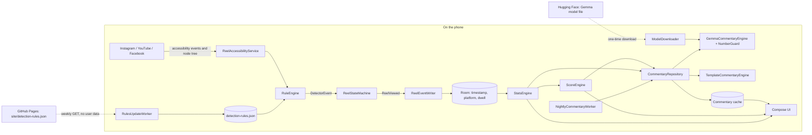

# Scroll Sloth

Scroll Sloth is an Android-only, on-device app for counting short-form video sessions in Instagram, YouTube Shorts, and Facebook Reels. The current build includes onboarding, rule-driven reel detection, daily/weekly/monthly statistics with laziness and unproductivity scores (with a "why this score" breakdown), on-device commentary (Gemma or templates), and the debug **Rule Inspector** used to collect the real UI structure that detection rules are built from.

- **Website and install guide:** https://jayant-jeet.github.io/Scroll-Sloth/
- **Download:** [latest release](https://github.com/Jayant-Jeet/Scroll-Sloth/releases/latest) (signed APK and its SHA-256 checksum)

## Architecture overview

- `app`: the only Android application module, written in Kotlin with Jetpack Compose and Material 3.
- `com.halfbloodcoder.scrollsloth.AppContainer`: hand-written dependency container created by `ScrollSlothApplication` and shared by the activity and the accessibility service (one DataStore instance per process).
- `com.halfbloodcoder.scrollsloth.detect`: supported platforms, the detection-rules schema, loader and repository, `RulesUpdater`/`HttpRulesFetcher` (rules fetch), `AppStatuses` (per-app status), `RuleEngine` (node tree → `DetectorEvent`), the pure-Kotlin `ReelStateMachine` (dwell, dedupe, resets), `ReelDetector` (glue), `ReelAccessibilityService`, and the enabled-service check.
- `com.halfbloodcoder.scrollsloth.data`: Room entities and DAO, the Room database, `ReelEventWriter` (a Channel drained by one writer coroutine), Preferences DataStore settings (onboarding, Inspector mode, tracking pause, week start, scoring config), `CsvExporter`, and `UserData` (export and delete-all).
- `com.halfbloodcoder.scrollsloth.debug`: the Rule Inspector — node snapshot serialiser, event ring buffer, capture storage, the floating Capture overlay, capture sharing, and the captures screen.
- `com.halfbloodcoder.scrollsloth.stats`: `PeriodCalendar` (day/week/month ranges in local time), the pure `StatsCalculator` (sessions, late night, baseline), `StatsEngine` (Flows for today, this week, this month and previous periods, refreshed at local midnight), and `PeriodCharts` (week bars, month heat map, best/worst day, chart descriptions for screen readers).
- `com.halfbloodcoder.scrollsloth.score`: `ScoreConfig` and `ScoreBands`, the deterministic `ScoreEngine`, `ScoreExplainer` (the "why this score" lines), and `ScoreConfigInput` (Settings form validation).
- `com.halfbloodcoder.scrollsloth.ai`: on-device commentary — `CommentaryEngine`, `StatsFacts`, `PromptBuilder`, `NumberGuard`, `TemplateCommentaryEngine` (fallback), `GemmaCommentaryEngine` (guard + one retry + fallback) over a `LanguageModel` seam implemented by `LiteRtLanguageModel`, `ModelDownloader`/`ModelFiles` (download and SHA-256 marker), and `CommentaryRepository` (facts for completed periods, cache, catch-up).
- `com.halfbloodcoder.scrollsloth.ui`: onboarding, the Today/Week/Month screens, Settings, shared components (score card with "why this score", commentary card with source badge, per-app split, banners, empty states), and light/dark theme. See [Screens](#screens).
- `com.halfbloodcoder.scrollsloth.work`: `NightlySchedule` (next 00:30 local, DST-safe), `NightlyCommentaryWorker`, and `RulesUpdateWorker`.

Room stores only event timestamps, platform identifiers, and dwell durations, plus a commentary cache (period key, tone, text, source, retries, created time).

### Diagram

Solid arrows stay on the phone. Dotted arrows are the only two network requests, and both are plain downloads of public files.



The language model only writes words. Every number comes from `StatsEngine` and `ScoreEngine`, and `NumberGuard` rejects any sentence with a number that isn't in the facts.

## Privacy statement

All app data is stored on the device. The only network requests are the optional one-time model download and the detection-rules fetch described below; both are plain downloads of public files and send no user data; the app includes no analytics or crash-reporting SDK. It never stores captions, usernames, video URLs, screen text, or reel content.

The accessibility service is limited in its XML configuration to exactly `com.instagram.android`, `com.google.android.youtube`, and `com.facebook.katana`, so Android never delivers events or window content from other apps. For detection, the service reads only structure from those windows: whether a reel screen is shown, the pager position, and (for Facebook) a hash of selected labels. That hash is kept in memory only, for at most the last 10 reels per app, and is never written to disk. Each counted reel is stored as a timestamp, a platform id, and a dwell time — nothing else. Rule Inspector captures contain structure only (see below); they stay in app-private storage until you choose to share them.

## Onboarding and accessibility access

Onboarding explains the permission and provides a shortcut to Android Accessibility settings. For sideloaded installations on Android 13+, the user may need to open **App info > menu > Allow restricted settings** before enabling the service.

## Rule Inspector

Third-party apps do not publish their UI structure, so detection rules must come from real captures rather than memory.

### Using it

1. Enable the Scroll Sloth accessibility service.
2. Open **Settings > Advanced** and turn on **Inspector mode**. A floating **Capture** button appears (drag it anywhere).
3. Open a supported app. Capture once while watching a reel (Instagram Reels, YouTube Shorts, Facebook Reels) and once on a non-reel screen such as the home feed.
4. Open **Settings > Advanced > Rule Inspector captures** to share captures as `.json` files (one or all) or delete them.

Turning Inspector mode off hides the button and clears the in-memory event log.

### Why an overlay button rather than a quick-settings tile

The button is a `TYPE_ACCESSIBILITY_OVERLAY` window owned by the accessibility service. It needs no extra permission (no "draw over other apps") and the target app stays in the foreground while you tap it. A quick-settings tile would need the notification shade open, which makes System UI the active window at the exact moment of capture, and would need an extra `TileService`.

The service also sets `flagRetrieveInteractiveWindows` (beyond the requested `flagReportViewIds`). Capture prefers the active window, but if tapping the overlay ever makes it the active window, the service falls back to the interactive window whose root belongs to a supported app. Window content of other packages is still never captured.

### Capture format (`schemaVersion` 1)

Files are named `capture-<platform>-<epochMs>.json`.

| Field | Meaning |
| --- | --- |
| `capturedAtEpochMs`, `capturedAtUptimeMs` | Capture time (wall clock and uptime, the latter matches event times) |
| `platform`, `app` | Platform and the app's `packageName`, `versionName`, `versionCode` — UI structure changes between app versions |
| `device` | `sdkInt` and screen size in pixels, to interpret `bounds` |
| `nodeCount`, `truncated` | Nodes captured; `truncated` is true if the 3000-node or 80-level depth cap was hit |
| `viewIds` | Sorted, distinct view IDs on screen — the quickest thing to diff |
| `recentEvents` | Last 30 events from supported apps: `type`, `packageName`, `className`, `scrollDeltaX/Y` (scroll events, Android 9+), `fromIndex`, `toIndex`, `itemCount` (absent when Android reports -1) |
| `root` | Node tree |

Each node has `path` (child indices from the root, e.g. `0.3.1`), `className`, `viewId`, `hasText`/`textLength`, `hasContentDescription`/`contentDescriptionLength`, `scrollable`, `bounds`, optional `collectionInfo`, `collectionItemInfo`, `rangeInfo`, `childCount`, and `children`. Actual text and content descriptions are never written — only whether they exist and their length.

### Reading which nodes differ

- Compare `viewIds` between a reel capture and a feed capture of the same app: IDs present only on the reel screen are candidate reel markers.
- For a finer diff, flatten each tree to `path viewId className scrollable` lines and diff them, e.g. with `jq`:

  ```shell
  jq -r '.root | recurse(.children[]?) | "\(.viewId // "-") \(.className) scrollable=\(.scrollable) \(.collectionInfo // "")"' capture-a.json > a.txt
  ```

- `recentEvents` shows which container scrolls (`TYPE_VIEW_SCROLLED` with `fromIndex`/`toIndex`) when you swipe between reels.

## How detection rules work

Detection is data-driven. A versioned `detection-rules.json` (`schemaVersion` 1, plus a `rulesVersion`) tells the app, for each supported package:

- `reelScreenMatchers`: nodes that must **all** be visible for the screen to count as a reel screen.
- `strategy`: `ITEM_CHANGED` (a new reel is a new pager position, read from collection/range info) or `KEY_CHANGED` (a new reel is a new hash of `keyFields`, e.g. `contentDescription`).
- `pagerMatcher`: the node that holds the pager or reel page.
- `keyFields` and optional `keyMatchers`: what to hash for `KEY_CHANGED`. `keyMatchers` restricts the hash to matching nodes so things that change during one reel (play/pause controls, like counts) do not look like a new reel.

A matcher can use `viewIdContains`, `classNameEquals`, `scrollable`, `minWidthFraction`, `minHeightFraction`, `minTopFraction` and `maxRightFraction` (fractions are of the window). Facebook obfuscates its view IDs, so its rule relies on class, size and position.

`minDwellMs` (2 s) and `maxDwellMs` (120 s) apply to all apps: a reel counts once after at least 2 s, when you move on or leave; loops are capped at 120 s; a reel seen again within 60 s is not counted twice.

### Bundled rules and calibration

The bundled `app/src/main/assets/detection-rules.json` contains only `"TODO_FROM_INSPECTOR"` values. Any rule containing a TODO, or a matcher with no conditions, is disabled, and Settings shows that app as **Needs calibration**. Nothing is counted for it.

Calibrated values are derived from Rule Inspector captures (`captures/<date>-<device>/`, currently one Samsung S24 Ultra on Android 16) and live in [`site/detection-rules.json`](site/detection-rules.json), which is also the published file. The rules unit tests replay those captures, so a rule change that stops matching them fails the build. To use them, either:

- open **Settings > Advanced > Import detection rules** and pick the file, or
- with a debug build: `adb push site/detection-rules.json /data/local/tmp/` then `adb shell "run-as com.halfbloodcoder.scrollsloth sh -c 'cat /data/local/tmp/detection-rules.json > files/detection-rules.json'"`.

The imported file overrides the bundled one until you choose **Use bundled rules**. Settings > Advanced also shows a live detector readout to check a rule while using an app. **Use bundled rules** also forgets downloaded rules.

### Rules updates

`RulesUpdateWorker` fetches `detection-rules.json` once every 7 days when a network is available, and **Settings > Detection rules > Check now** runs the same check on demand. The request is a plain HTTPS GET of a public file. It sends only two fixed headers (`Accept: application/json`, `User-Agent: ScrollSloth-rules`) and no query parameters, cookies, identifiers or user data. It uses no cache, 15 s timeouts and a 256 KB limit, and does not follow redirects.

A downloaded file is kept only if all of these hold:

- it parses against the schema (`schemaVersion` 1, all fields present and well typed, valid dwell limits);
- its `rulesVersion` is higher than the current rules;
- at least one app in it is calibrated. An app whose rule still has a `TODO_FROM_INSPECTOR` value is only disabled.

It is written atomically: a temporary file is synced, then moved over the old one. The rules it replaces are kept as a last-good copy. If the current file is ever unreadable, the app falls back to the last-good copy and then to the bundled rules. Any network or validation error leaves the current rules untouched. Settings shows the version, its source (bundled, imported or downloaded) and when the server last answered.

The default address is `https://jayant-jeet.github.io/Scroll-Sloth/detection-rules.json`. The `pages.yml` workflow publishes [`site/detection-rules.json`](site/detection-rules.json) there, and also at the older `/docs/detection-rules.json` address used by builds from before the first release. To ship new rules, update that file and raise its `rulesVersion` (see [Contributing detection rules](#contributing-detection-rules)).

- **Settings > Advanced > Rules update address** changes the address. It must be `https://` with no user name or password. Leave it empty to turn updates off, or tap **Use default** to restore the build default. The weekly worker is scheduled or cancelled to match.
- **At build time**, `-PrulesUrl=https://...` changes the default, and `-PrulesUrl=` builds with updates off.

## Calibration

**Settings > Advanced > Calibration** measures how well the detector matches what you actually watched:

1. Pick Instagram, YouTube or Facebook and tap **Start**. Start is disabled while counting is paused, the accessibility permission is off, or the app still needs calibration.
2. Watch reels in that app. Tap the floating purple **+1** button (left edge, away from the like and comment buttons) once for each reel you really watched. Don't tap for reels you flicked past. You can drag the button anywhere.
3. Come back and tap **Stop**. The screen shows the detector's count next to yours, the absolute error, and the percentage error relative to your count.

The detector's count stays hidden while a run is going, so it can't sway you. Any reel already open at Start is excluded, and the reel open at Stop is included. **Discard** throws a run away.

Each run appends one row to `calibration.csv` in app storage with these columns: `started_at,platform,auto,manual,duration_sec,rules_version,app_version_name`. `app_version_name` is the version of the app being calibrated, so a rule regression can be tied to an app update. **Export calibration CSV** shares the file. **Delete all data** erases it.

## Contributing detection rules

Instagram, YouTube and Facebook change their screens without notice. When an update renames or restructures the reel viewer, counting for that app stops or drifts. Fixing it means capturing the new structure and publishing new rules, with no app release needed.

**1. Confirm the breakage.** You may see any of these:

- The day's count stops rising for one app.
- **Settings > Advanced > Live detector** says "not on a reel screen" while a reel is playing.
- A **Calibration** run shows a large error.

Note the app's version (Android **App info**). Captures record it too.

**2. Capture the new structure** with the [Rule Inspector](#rule-inspector):

- Turn on **Inspector mode**.
- In the updated app, capture the home feed (a non-reel screen), a reel, and the next reel after one swipe. For Facebook, also capture one reel both playing and paused.
- Share the captures from **Rule Inspector captures**. They hold structure only: view IDs, classes, bounds, and whether text exists, never the text itself.

**3. Find what changed.** Diff `viewIds` and the flattened trees between the feed and reel captures (see [Reading which nodes differ](#reading-which-nodes-differ)). You are looking for:

- a node that exists only on the reel screen and fills the screen (for `reelScreenMatchers`), and
- the pager, whose page `collectionItemInfo.rowIndex` changes when you swipe (`ITEM_CHANGED`).
- If there is no usable index, use stable labels on the page instead (`KEY_CHANGED` with `keyFields`/`keyMatchers`).

Use only values you can see in the captures. Never guess IDs.

**4. Update the rules and their tests.**

- Edit [`site/detection-rules.json`](site/detection-rules.json) and raise `rulesVersion`. The convention is `YYYYMMDDNN`, for example `2026102101`. Phones ignore a file whose version isn't higher than the one they have.
- Add the captures under `captures/<date>-<device>/`.
- Point [`RuleEngineCaptureTest`](app/src/test/java/com/reelsloth/detect/RuleEngineCaptureTest.kt) at them: the feed must not be a reel screen, and consecutive reels must give different indices or keys. The rules describe the current app version, so replace tests for old captures that no longer apply.

**5. Check it locally and on a phone.**

```shell
./gradlew testDebugUnitTest --tests "com.halfbloodcoder.scrollsloth.detect.*"
```

- Import the file with **Settings > Advanced > Import detection rules**.
- Do a **Calibration** run of 10 or more reels. Put the exported CSV row (auto, manual, `app_version_name`) in the pull request.

**6. Open a pull request.** The **Validate rules** check runs the published-rules check in [`PublishedRulesCheck`](app/src/test/java/com/reelsloth/detect/PublishedRulesCheck.kt) through the app's own parser. It fails when:

- the schema is wrong, or a key is misspelt or unknown;
- an app isn't one of the three supported packages;
- a non-placeholder rule is broken;
- no app is calibrated;
- `rulesVersion` isn't above the bundled rules.

After merging, `pages.yml` validates again, then deploys. Phones pick the file up within a week, or straight away with **Settings > Detection rules > Check now**.

## Statistics and scores

All numbers are computed on the device by plain Kotlin from the stored events. The language model will never compute or change them.

**Statistics** (`PeriodStats`), in the phone's time zone:
- A reel belongs to the local day it started on. Minutes = total dwell time / 60 000.
- Weeks start on Monday by default (Settings > Week starts on).
- A session is a run of reels where each starts less than 5 minutes after the previous one ended. A session that crosses midnight is split between the two days for daily figures, and counted whole in the week or month.
- Late night = reels started between 23:00 and 04:59.
- Baseline = median daily count over the 28 days before the day (or period), counting only days since your first recorded reel, with zero days included. It is empty until there are at least 7 such days.

**Scores** per day, with `clamp` limiting to 0..1 (defaults are editable in Settings > Advanced):

| Component | Formula | Weight |
|---|---|---|
| Volume | `clamp(reels / heavyDaily) * 100` (heavyDaily = 200) | 45% |
| Above your usual | `clamp(reels / baseline - 1) * 100`, 0 without a baseline | 15% |
| Late night | `clamp(lateShare / lateShareHeavy) * 100` (lateShareHeavy = 50%) | 20% |
| Longest session | `clamp(longestSession / sessionHeavy) * 100` (sessionHeavy = 100) | 20% |

Laziness is the weighted sum of these. Unproductivity = `clamp(minutes / (dailyMinutesBudget * 4)) * 100`, where dailyMinutesBudget = 30.

Week and month scores are the mean of the daily scores, and days with no reels count as 0. For the current week or month, only the days up to today are averaged. Scores are rounded half up, then banded as follows (the labels are editable):
0-19 Fully awake, 20-39 Casual scroller, 40-59 Sofa sloth, 60-79 Reel hibernator, 80-100 Fossilised.

## Screens

All screens use Material 3 with light and dark themes and are drawn with plain Compose (charts use `Canvas`, no charting library). Charts have a spoken description for screen readers, and touch targets are at least 48 dp.

- **Today:** today's count and minutes, yesterday for comparison, laziness and unproductivity cards (band label, meter and a "Why this score" expander listing each component), the per-app split, and yesterday's verdict with a **Gemma** or **Template** badge and the Gentle/Roast toggle. While Gemma downloads, the card says templates are used until it is ready.
- **Week:** seven bars of reels per day with today highlighted (future days are stubs), week total, average per tracked day, weekly scores and last week's verdict.
- **Month:** a calendar heat map (shade = quarters of `heavyDaily`, today outlined), month total, best and worst finished day (from 2 tracked days; ties go to the earlier day), monthly scores and last month's verdict.
- **Settings:** pause counting, accessibility status, per-app status (**Working**, **Needs calibration**, **Permission missing**; calibration is reported first because an uncalibrated app is never counted), commentary tone, week start, the on-device writer (download, progress, delete), detection rules (version, source, last check, **Check now**), your data (**Export CSV**, **Delete all data** with confirmation), and **Advanced** (score settings, write commentary now, Rule Inspector tools, rules import/reset, live detector).
- **Empty and blocked states:** a banner explains when nothing can be counted (permission off, counting paused, or no calibrated app), and empty days, weeks and months get a friendly note instead of zero-value scores.

**Pause counting** stops detection in the accessibility service immediately. A reel already on screen for at least the minimum dwell when you pause still counts, just as if you had left the app.

**Export CSV** writes `scroll-sloth-reels-<date>.csv` (`timestamp_ms,local_time,platform,dwell_ms`) to the app cache and opens the share sheet; nothing leaves the phone unless you pick a target. **Delete all data** removes every counted reel, all commentary, Inspector captures and old exports. Settings, detection rules and the downloaded model are kept.

## Commentary

Each period screen shows a short verdict on the last completed day, week or month ("Yesterday's verdict", etc.). The UI only reads a cache, so it never waits for a model.

- **Writer.** [LiteRT-LM](https://ai.google.dev/edge/litert-lm) 0.18.0 (MediaPipe LLM Inference is in maintenance mode) running **Gemma 4 E2B instruction-tuned** (`gemma-4-E2B-it-gpu.litertlm`, ~1.9 GB, Apache 2.0, not gated, so no token or accepted terms are needed). GPU backend only (this file has no CPU sections; if the GPU cannot load it, templates are used), FLOAT32 activations, greedy decoding (top-k 1, temperature 0.1), at most 60 output tokens, thinking off. The engine is loaded per job and closed straight after; a verdict takes a few seconds on a Galaxy S24 Ultra. With the default FLOAT16 activations that phone produced garbled words ("you watchedヒル closely"), matching [LiteRT-LM #3879](https://github.com/google-ai-edge/LiteRT-LM/issues/3879); FLOAT32 with a separate GPU cache directory fixes it.
- **Prompt.** `PromptBuilder` sends only a JSON block of facts (reels, minutes, band, late-night reels, previous-period reels, delta) and the rules: two sentences max, no medical or mental-health claims, no insults about the person's worth, the requested tone (Gentle or Roast), and only the numbers given.
- **NumberGuard.** Every number in the reply (digits, decimals, percentages, and number words up to twenty, plus tens) must be in an allow-list built from the facts and simple derived values (rounded percentage change, late-night share, hours from minutes). Empty text, text over 300 characters, banned phrases, and letters from non-Latin scripts (a sign of garbled output; emoji, accents and a renamed band label pass) are rejected. On failure the model gets one retry naming the rejected numbers; a second failure falls back to the template engine. The cache records `source` (GEMMA or TEMPLATE) and `retries`, and the card says "Written by Gemma on your phone" or "Template".
- **Templates.** `TemplateCommentaryEngine` has 5 to 8 deterministic templates per band and tone. It is always available and is used before the model is downloaded.
- **Nightly job.** `NightlyCommentaryWorker` runs at about 00:30 local time while charging and idle. It writes any missing verdict for the latest completed day, week and month, so the weekly verdict appears on the week-start day, the monthly one on the 1st, and missed nights catch up. A template verdict is rewritten once the model is ready, and every verdict is rewritten when the tone changes. It is a one-time job that re-arms itself for the next 00:30 (periodic work drifts under charging/idle constraints). Settings > Advanced > **Write commentary now** runs it immediately without constraints.
- **Download.** Settings > On-device writer. Uses Android `DownloadManager` (resumable, survives app restarts), Wi-Fi only unless "Allow mobile data" is on, into the app-specific external files dir (`Android/data/com.halfbloodcoder.scrollsloth/files/models`). The URL is pinned to a Hugging Face revision, and the file must match the pinned size and SHA-256. A marker file records the verified size and modification time; on every start the app checks the file against the marker and deletes and re-downloads it if they do not match. Needs the model size plus 200 MB free.

## Build and test

**Requirements:** JDK 17 or newer (Android Studio's bundled JBR works), and the Android SDK with platform 37.0 (`platforms;android-37.0`) and build-tools 36.0.0. Point `local.properties` (`sdk.dir=...`) or `ANDROID_HOME` at the SDK.

```shell
./gradlew testDebugUnitTest assembleDebug     # all unit + Compose UI tests, then the debug APK
./gradlew installDebug                        # install on a connected phone (adb)
```

The debug APK is `app/build/outputs/apk/debug/app-debug.apk`. Compose UI tests (for example `TodayScreenTest`: no permission, no data, normal, model downloading) run under Robolectric as part of `testDebugUnitTest`, so no emulator is needed.

Build options (Gradle properties):

- `-PrulesUrl=https://...` sets the default rules address. `-PrulesUrl=` builds with rule updates off.
- `-PversionName=1.2.3 -PversionCode=10203` set the version. The release workflow derives both from the tag.

**Signed release builds.** `assembleRelease` signs only when `RELEASE_KEYSTORE_FILE` is set, together with `KEYSTORE_PASSWORD`, `KEY_ALIAS` and `KEY_PASSWORD`. Without it, the output is `app-release-unsigned.apk`.

### Continuous integration and publishing

| Workflow | When | What it does |
| --- | --- | --- |
| [`ci.yml`](.github/workflows/ci.yml) | every pull request | `./gradlew testDebugUnitTest assembleDebug` |
| [`validate-rules.yml`](.github/workflows/validate-rules.yml) (**Validate rules**) | every pull request; called by `pages.yml` | Checks that `site/detection-rules.json` matches the schema and is publishable |
| [`release.yml`](.github/workflows/release.yml) | a pushed tag `v*` | Runs the tests, builds a signed release APK, and creates a GitHub Release with generated notes, the APK and its `.sha256`. A tag like `v1.2.3-beta.1` makes a pre-release. |
| [`pages.yml`](.github/workflows/pages.yml) | a push to `main` that touches `site/`, or by hand | Validates the rules, then deploys `site/` (landing page and `detection-rules.json`) to GitHub Pages |

One-time setup:

- **Release secrets** (Settings > Secrets and variables > Actions):
  - `KEYSTORE_BASE64`: the keystore, base64-encoded. On Linux or macOS: `base64 -w0 release.jks`. In PowerShell: `[Convert]::ToBase64String([IO.File]::ReadAllBytes('release.jks'))`.
  - `KEYSTORE_PASSWORD`, `KEY_ALIAS`, `KEY_PASSWORD`.
  - Keep the keystore safe: Android only installs updates signed with the same key.
- **Pages:** Settings > Pages > Source must be **GitHub Actions**.

To publish a release: `git tag v1.0.0 && git push origin v1.0.0`.

## Limitations

- **Android only.** iOS has no equivalent of the accessibility service, so it cannot observe other apps.
- **It depends on third-party UI.**
  - Detection reads the screen structure of Instagram, YouTube and Facebook, which they can change in any update.
  - When that happens, counting for that app stops or drifts until someone publishes new rules (see [Contributing detection rules](#contributing-detection-rules)).
  - The rules were calibrated on one phone (Galaxy S24 Ultra, Android 16). Other screen sizes, app versions, A/B tests or languages may differ.
- **Three apps only.** TikTok, Snapchat and others are not supported. The service is restricted to these three packages on purpose.
- **Close, not exact.**
  - A reel counts after 2 s of dwell; looping reels are capped at 120 s.
  - A reel seen again within 60 s isn't recounted.
  - Picture-in-picture, split-screen, and reels inside other surfaces (such as DMs or Stories) may be missed.
- **Sideloaded only for now.** On Android 13+ you must allow restricted settings before enabling the service.
- **The on-device writer needs a capable GPU** and about 2 GB of storage. Without it, commentary comes from templates.
